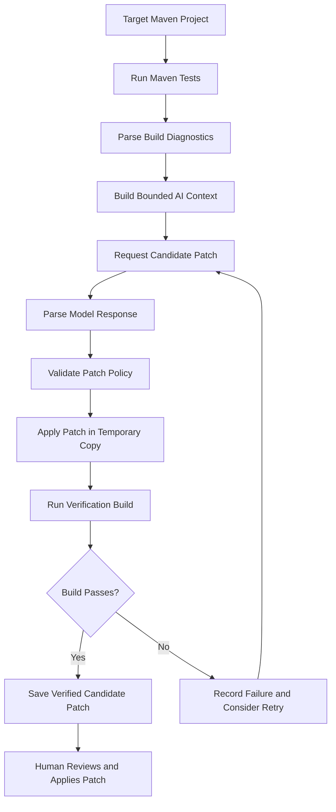
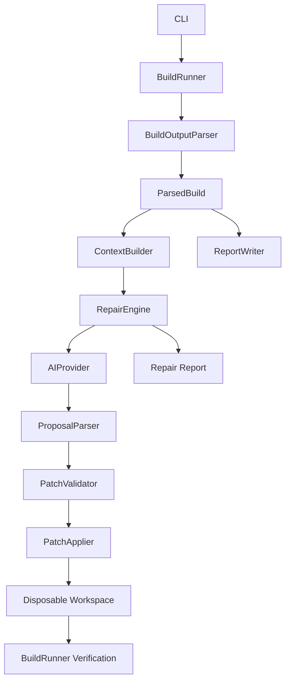

# CompileLoop

[](https://github.com/LambdaJedi/compileloop/actions/workflows/ci.yml)

**A local-first AI code repair engine built in Java.**

CompileLoop helps diagnose and repair failing Maven projects using locally hosted AI models. It captures build diagnostics, generates candidate patches, validates proposed changes against strict policies, and verifies them in a disposable copy of the project.

The goal is simple: **let AI propose the fix while deterministic engineering controls decide whether that fix is safe to consider.**

CompileLoop is designed around human review, reproducible results, and a complete record of each repair attempt.

## Table of Contents

- [Features](#features)
- [How It Works](#how-it-works)
- [Quick Start](#quick-start)
- [Providers](#providers)
- [Example Output](#example-output)
- [Project Examples](#project-examples)
- [Commands](#commands)
- [Architecture](#architecture)
- [Safety and Validation](#safety-and-validation)
- [Using CompileLoop as a Java Library](#using-compileloop-as-a-java-library)
- [Benchmark](#benchmark)
- [Project Structure](#project-structure)
- [Known Limitations](#known-limitations)
- [Development](#development)
- [Roadmap](#roadmap)
- [Design Principle](#design-principle)
- [License](#license)

## Features

- **Local AI inference:** Uses [Ollama](https://ollama.com/) to run code models locally without requiring paid AI APIs.
- **OpenAI-compatible endpoints:** Any endpoint that speaks the OpenAI chat completions shape works as a provider, including self-hosted aggregators such as FreeLLMAPI.
- **Automated build diagnostics:** Runs Maven tests and extracts compilation errors, test failures, and other build information.
- **AI-assisted repair:** Supplies bounded diagnostic context to a model and requests a unified-diff patch.
- **Strict patch validation:** Rejects changes that violate file, path, extension, size, or other policy restrictions.
- **Disposable workspaces:** Tests proposed patches in a temporary project copy rather than modifying the original working tree.
- **Docker-based build executor:** An optional executor runs the verification build inside a container with memory and CPU limits, so the caller's directory is never the mount.
- **Verified candidate patches:** Produces a Git-compatible patch when the modified project passes the verification build.
- **Auditability:** Preserves model responses, validation results, build logs, reports, and repair attempts.
- **Offline testing support:** Includes a mock AI provider and replayable model responses for testing without a running model.
- **Cross-platform support:** Tested on Windows and Linux, with CI configured for both.
- **Java-first architecture:** Built around small components with clear responsibilities and an extensible AI provider interface.
- **Library API:** The repair loop is callable from Java, not just from the CLI.

## How It Works

CompileLoop follows a controlled repair pipeline:



The process works as follows:

1. **Run the baseline build.** CompileLoop executes Maven tests and captures the output.
2. **Parse diagnostics.** Recognised errors are converted into structured records containing information such as file paths, line numbers, messages, and diagnostic categories.
3. **Build context.** The engine selects relevant source files and diagnostic information for the model.
4. **Generate a proposal.** The configured AI provider returns a structured response containing a summary and unified diff.
5. **Validate the proposal.** The patch must satisfy the configured policy before it can be applied.
6. **Create a disposable workspace.** The validated patch is applied to a copy of the project.
7. **Verify the candidate.** Maven tests run again inside the temporary copy.
8. **Record the result.** CompileLoop saves the patch and supporting artifacts when verification succeeds.
9. **Require human approval.** You inspect the patch and decide whether to apply it to your actual project.

A successful verification means the candidate passed the configured build checks. It does not prove that the code is correct, secure, or free from regressions.

## Quick Start

### Prerequisites

- JDK 17 or later
- Maven 3.9 or later
- [Ollama](https://ollama.com/) installed and running
- A compatible local code model

### 1. Clone the repository

```bash
git clone https://github.com/LambdaJedi/compileloop.git
cd compileloop
```

### 2. Build the project

```bash
mvn -B -DskipTests package
```

### 3. Download a local code model

```bash
ollama pull qwen2.5-coder:7b
```

Ensure the Ollama service is running before starting a repair.

### 4. Repair the bundled example

```bash
java -jar target/compileloop-0.1.0-SNAPSHOT.jar repair \
  examples/broken-compilation-project \
  --model qwen2.5-coder:7b
```

CompileLoop will attempt to repair the example and verify the proposed patch in a disposable copy.

The resulting patch is written under:

```text
examples/broken-compilation-project/target/compileloop/repairs/<run-id>/fix.patch
```

**The original example's `src/` files remain unchanged.** Review the generated patch before applying it.

To apply a patch you have approved, run the following from the target project directory:

```bash
git apply "path/to/fix.patch"
```

Replace the example path with the actual path printed by CompileLoop.

## Providers

CompileLoop supports two kinds of AI provider. Both are configured entirely through command-line flags; no code changes are required to switch between them.

### Ollama (default)

Local inference with no API key and no network access beyond localhost. This is the default and the recommended path for individual use.

```bash
java -jar target/compileloop-0.1.0-SNAPSHOT.jar repair \
  examples/broken-compilation-project \
  --model qwen2.5-coder:7b
```

The `--ollama-url` flag changes the endpoint. The default is `http://localhost:11434`.

### OpenAI-compatible endpoints

Any endpoint that exposes the OpenAI `/v1/chat/completions` shape works as a provider. This includes hosted services, self-hosted gateways, and aggregators such as [FreeLLMAPI](https://github.com/tashfeenahmed/freellmapi), which combines many free-tier providers behind one API.

```bash
java -jar target/compileloop-0.1.0-SNAPSHOT.jar repair \
  examples/broken-compilation-project \
  --provider openai \
  --openai-base-url http://localhost:3001/v1 \
  --api-key-env FREELLMAPI_KEY \
  --model gpt-4o-mini
```

The `--api-key-env` flag reads the key from an environment variable, which keeps it out of the process list and shell history. The `--api-key` flag is also supported for scripts where the environment is not controlled; it is visible to `ps` and should be treated as less safe.

The `--openai-base-url` should point at the API root — for example `http://localhost:3001/v1` — and `/chat/completions` is appended internally. The API key is never written to an error message, a log line, or the audit trail. That invariant has a dedicated test.

When `provider=openai` is set, `--openai-base-url` and one of `--api-key` / `--api-key-env` are required. The two key flags are mutually exclusive. `--response-file` still works as a way to replay a saved answer without touching a model.

Both providers pass through the same strict `ProposalParser`, so a response that isn't exactly one JSON object with the expected fields is rejected the same way regardless of who produced it.

## Example Output

A repair run can produce output similar to the following:

```text
CompileLoop repair
Baseline build: FAIL (1 compile error(s), 0 test failure(s))

Attempt 1: VERIFIED
  Model says: Add a semicolon at the end of the return statement.
  The build passes with this patch.

Result: VERIFIED_CANDIDATE
Human approval: REQUIRED

Attempt 1 produced a patch whose build passes in a disposable copy.
Your working tree is unchanged; review fix.patch and apply it yourself.
```

The exact output, timings, and repair result depend on the project and the model response.

### What gets recorded?

Each run preserves its own artifacts, including:

- The original Maven build log
- A structured JSON report
- A human-readable report
- The model's exact response
- The raw and normalized patch
- Patch validation results
- Verification build output
- Attempt statuses and timing information

This makes it possible to inspect what the engine attempted and why a candidate was accepted or rejected.

## Project Examples

CompileLoop includes three small Maven projects for exercising different build scenarios:

| Example | Purpose |
|---|---|
| `examples/passing-java-project` | A project whose build passes |
| `examples/broken-compilation-project` | A project with an intentional compilation defect |
| `examples/failing-test-project` | A project with a failing test |

These examples help demonstrate baseline testing, diagnostic parsing, and candidate repair.

## Commands

| Command | Description |
|---|---|
| `test <dir>` | Run the project's Maven tests and produce a report |
| `test <dir> --json` | Output the test report as JSON |
| `repair <dir> --model <name>` | Generate, validate, and verify a candidate patch |
| `repair <dir> --response-file <file>` | Replay a saved model response without making a live model request |
| `report <run-dir>` | Re-render a stored report |

The commands above are invoked through the packaged JAR.

### Test options

| Option | Description |
|---|---|
| `--timeout <seconds>` | Build timeout; defaults to 300 seconds |
| `--json` | Output the JSON report instead of the text summary |

Example:

```bash
java -jar target/compileloop-0.1.0-SNAPSHOT.jar test path/to/project
```

### Repair options

| Option | Description |
|---|---|
| `--provider <name>` | `ollama` (default) or `openai` |
| `--model <name>` | Model name (required unless `--response-file`) |
| `--ollama-url <url>` | Ollama endpoint; defaults to `http://localhost:11434` |
| `--openai-base-url <url>` | Base URL of an OpenAI-compatible endpoint (`provider=openai`) |
| `--api-key <key>` | API key (`provider=openai`; visible in the process list) |
| `--api-key-env <VAR>` | Read the API key from an environment variable (safer) |
| `--response-file <file>` | Use a saved model response instead |
| `--attempts <n>` | Maximum repair attempts; defaults to 3, with a hard cap of 10 |
| `--timeout <seconds>` | Build timeout per run; defaults to 300 seconds |
| `--ai-timeout <seconds>` | Model request timeout per attempt; defaults to 300 seconds |
| `--allow-test-changes` | Permit modifications under `src/test/java`; disabled by default |
| `--json` | Output the JSON report instead of the text summary |

### Exit codes

#### `test` command

| Exit code | Meaning |
|---|---|
| `0` | Build passed |
| `1` | Build failed |
| `2` | Build timed out |
| `3` | Build could not be started |
| `64` | Invalid command usage |

#### `repair` command

| Exit code | Meaning |
|---|---|
| `0` | Build already passed or a verified candidate was produced |
| `1` | Repair unsuccessful or no progress made |
| `3` | Model unavailable or infrastructure error |
| `64` | Invalid command usage |

## Architecture

CompileLoop separates build execution, diagnostic parsing, AI interaction, patch validation, workspace management, and reporting.



### Core components

- **BuildRunner** — Launches Maven using an argument list, captures output, enforces timeouts, and terminates the process tree when required.
- **DockerBuildExecutor** — An alternative `BuildExecutor` that runs the build inside a Docker container with memory and CPU limits.
- **BuildOutputParser** — Converts Maven console output into structured compilation errors and test failures. Unrecognised error lines are retained separately.
- **ContextBuilder** — Selects bounded diagnostic and source context from permitted source roots.
- **AIProvider** — Defines the interface for AI backends. CompileLoop includes `OllamaProvider`, `OpenAICompatibleProvider`, and `MockProvider`.
- **ProposalParser** — Accepts a strictly structured model response containing a summary, a diff, and optional assumptions.
- **UnifiedDiff** — Parses unified diffs without directly modifying project files.
- **UnifiedDiffWriter** — Renders parsed patches back to canonical, Git-applicable text.
- **PatchPolicy** — Defines allowed roots, extensions, protected paths, and change-size limits.
- **PatchValidator** — Rejects patches that violate the configured policy.
- **PatchApplier** — Applies validated patches using strict matching and all-or-nothing semantics.
- **Workspace** — Creates a disposable project copy for verification.
- **RepairEngine** — Coordinates repair attempts, verification, result recording, and early stopping conditions.
- **ReportWriter** — Produces structured JSON and human-readable build reports.
- **CompileLoop** — The library-facing facade. A single builder for callers who do not go through the CLI.

### Extensibility

The `AIProvider` interface separates the repair engine from the underlying model. A new provider can be implemented without replacing the build, validation, or reporting pipeline.

The `RepairEngine.BuildExecutor` interface separates the repair loop from how the build runs. The default runs Maven on the host; `DockerBuildExecutor` runs it inside a container. A caller can supply their own executor through the library API without touching the engine.

The included mock provider also allows the repair engine to be tested without depending on a live Ollama service.

## Safety and Validation

CompileLoop treats AI-generated output as untrusted input.

### Strict response parsing

The model must return exactly one JSON object with the expected fields:

- `summary`
- `diff`
- `assumptions` (optional)

Unexpected fields, Markdown fences, trailing text, and malformed responses are rejected.

### Patch policy enforcement

By default, modifications are restricted to permitted Java source files under:

- `src/main/java`
- `src/test/java`

Changes to test sources are disabled by default and require the `--allow-test-changes` option.

The validator rejects prohibited changes, including:

- Build configuration files
- CI configuration and Git metadata
- Shell and script files
- Binary files
- Renames, copies, deletions, and file-mode changes
- Symlinks
- Absolute paths and path traversal
- Reserved Windows device names
- Changes exceeding configured limits

The validator reports violations rather than accepting a partially valid patch.

### Strict patch application

The patch must match the expected source context. The engine can tolerate limited line-number drift, but ambiguous matches are rejected instead of guessed.

Line endings are preserved, and a patch is applied all-or-nothing.

### No model-generated shell commands

CompileLoop does not concatenate AI-generated text into shell commands. Build processes are launched using argument lists.

### No silent changes

CompileLoop does not automatically apply a successful candidate to your original working tree. It writes a patch that you can inspect and apply yourself.

### Explicit stopping conditions

The repair loop can stop early when it encounters repeated identical patches or consecutive attempts that produce the same diagnostic signature.

This prevents CompileLoop from wasting its entire attempt budget repeating an unchanged, unsuccessful proposal.

### API keys

When `provider=openai` is used, the API key is never written to a log line, an error message, or the audit trail. `--api-key-env` reads the key from an environment variable at construction time. There is a dedicated test asserting that the key cannot leak into any error message the provider produces.

### Important security warning

**CompileLoop is not a security sandbox.**

Although verification takes place in a disposable project copy, Maven still executes project code and the patched code with the current user's permissions.

The `DockerBuildExecutor` runs the build inside a container with memory and CPU limits, and binds only a temporary copy of the project — never the caller's directory. This provides fault isolation and separation from the host process tree. It is not a substitute for a hardened sandbox against a determined attacker.

Do not run CompileLoop against untrusted repositories unless you are prepared to execute their build logic in your environment.

For the full discussion, see [`docs/known-limitations.md`](docs/known-limitations.md).

## Using CompileLoop as a Java Library

The build and repair components can also be called directly from Java.

### Run a build and inspect diagnostics

```java
BuildRunner runner = new BuildRunner();

BuildResult result =
        runner.runMavenTests(Path.of("path/to/maven/project"));

System.out.println(result.outcome());

for (var error : result.parsed().compileErrors()) {
    System.out.printf(
            "%s:%d:%d %s%n",
            error.file(),
            error.line(),
            error.column(),
            error.message()
    );
}

for (var failure : result.parsed().testFailures()) {
    System.out.printf(
            "%s.%s (line %d): %s%n",
            failure.testClass(),
            failure.testMethod(),
            failure.line(),
            failure.message()
    );
}
```

### Run the repair engine

The simplest entry point is the `CompileLoop` facade. Every field has a default except the project directory and the provider, so the minimal call is two lines.

```java
RepairResult result = CompileLoop.repair()
        .project(Path.of("path/to/maven/project"))
        .provider(AIProvider.ollama("http://localhost:11434", "qwen2.5-coder:7b"))
        .run();

if (result.verifiedCandidate()) {
    Path patch = result.patchFile();

    // Review the patch before applying it.
}
```

A more configured call, showing the pluggable build executor:

```java
RepairResult result = CompileLoop.repair()
        .project(Path.of("path/to/maven/project"))
        .provider(AIProvider.openAiCompatible(
                "http://localhost:3001/v1",
                System.getenv("FREELLMAPI_KEY"),
                "gpt-4o-mini"))
        .executor(new DockerBuildExecutor())
        .maxAttempts(5)
        .buildTimeout(Duration.ofMinutes(5))
        .allowTestChanges(false)
        .run();
```

The builder collects the same `RepairEngine.Config` the CLI uses and delegates to `RepairEngine.repair`. It adds no behaviour of its own.

### Implement a custom provider

The `AIProvider` interface is a single method. A new backend implements it and nothing else:

```java
public final class MyProvider implements AIProvider {
    @Override
    public PatchProposal proposeRepair(RepairContext context) throws AIProviderException {
        // Send context.render() somewhere, parse the reply with ProposalParser,
        // return a PatchProposal. Never write to the project filesystem.
    }
}
```

These examples illustrate the intended API. Adapt imports and package names to the version you are using.

## Benchmark

Twenty tiny Maven fixtures, each with exactly one deliberate defect, run against three local code models. All fixtures and the runner live under `benchmarks/`.

| Model | Repair rate | Compile recovery | Test recovery | Mean latency |
|---|---|---|---|---|
| `qwen2.5-coder:7b` | 9/20 (45%) | 6/15 (40%) | 3/5 (60%) | 29s |
| `qwen2.5-coder:1.5b` | 4/20 (20%) | 4/15 (27%) | 0/5 (0%) | 12s |
| `deepseek-coder:6.7b` | 1/20 (5%) | 0/15 (0%) | 1/5 (20%) | 39s |

Out of 60 runs, the loop's stop conditions fired 27 times: 21 as `NO_PROGRESS` (identical patch or unchanged diagnostics) and 6 as `AI_UNAVAILABLE`. The remaining runs either verified a candidate, exhausted the attempt budget (`NOT_FIXED`), or hit an infrastructure error.

**Note on `deepseek-coder:6.7b`.** The model identifies the correct fix in its summary but produces unified diffs whose context lines do not match the source file, so `PatchApplier` rejects them as `DID_NOT_APPLY`. This is a known behaviour of completion-oriented code models: they generate plausible-looking diffs by pattern rather than by copying the exact source lines. Its low score reflects that mismatch, not an inability to diagnose the bug.

Methodology and per-fixture results: [`benchmarks/README.md`](benchmarks/README.md).

To run the benchmark:

```bash
bash benchmarks/run.sh
```

## Project Structure

```text
compileloop/
├── src/
│   ├── main/java/dev/compileloop/
│   │   ├── CompileLoop.java
│   │   ├── cli/
│   │   │   ├── Main.java
│   │   │   ├── Cli.java
│   │   │   └── RepairOptions.java
│   │   ├── build/
│   │   │   ├── BuildRunner.java
│   │   │   ├── DockerBuildExecutor.java
│   │   │   ├── BuildResult.java
│   │   │   ├── BuildOutcome.java
│   │   │   ├── BuildOutputParser.java
│   │   │   ├── ParsedBuild.java
│   │   │   ├── DiagnosticCategory.java
│   │   │   ├── ReportWriter.java
│   │   │   └── TextReport.java
│   │   └── repair/
│   │       ├── RepairEngine.java
│   │       ├── RepairResult.java
│   │       ├── RepairReport.java
│   │       ├── AIProvider.java
│   │       ├── OllamaProvider.java
│   │       ├── OpenAICompatibleProvider.java
│   │       ├── MockProvider.java
│   │       ├── RepairContext.java
│   │       ├── ContextBuilder.java
│   │       ├── ProposalParser.java
│   │       ├── UnifiedDiff.java
│   │       ├── UnifiedDiffWriter.java
│   │       ├── PatchPolicy.java
│   │       ├── PatchValidator.java
│   │       ├── PatchApplier.java
│   │       └── Workspace.java
│   └── test/
│       └── resources/maven/
├── benchmarks/
│   ├── fixtures/
│   ├── results/
│   ├── README.md
│   └── run.sh
├── examples/
│   ├── passing-java-project/
│   ├── broken-compilation-project/
│   └── failing-test-project/
├── docs/
│   └── known-limitations.md
├── pom.xml
└── README.md
```

The repository also contains CI configuration, benchmark tooling, test fixtures, and additional documentation.

## Known Limitations

CompileLoop is an experimental code repair engine, and several limitations remain:

- **Model reliability:** A model may misdescribe what its patch actually changes. Always inspect the diff instead of relying on the model's summary.
- **Limited isolation:** A disposable workspace protects the original source files from direct patch application, but it does not isolate code execution from the host system. The Docker executor provides fault isolation with resource limits, not a hardened sandbox against a determined attacker.
- **Regression detection:** A candidate may pass the target build while breaking behaviour that was previously working. Regression detection is a planned improvement.
- **Build-tool scope:** The current implementation targets Maven projects and Java source files.
- **Verification scope:** A passing build only verifies the checks that actually ran. It does not establish correctness, security, or production readiness.
- **Provider variability:** Different OpenAI-compatible endpoints may or may not support JSON mode. The provider defaults to requesting it; if a specific endpoint rejects the request, the `OpenAICompatibleProvider` can be constructed with JSON mode disabled. The CLI currently uses the default.

More details are available in [`docs/known-limitations.md`](docs/known-limitations.md).

## Development

Run the test suite:

```bash
mvn -B clean test
```

Build the runnable JAR:

```bash
mvn -B -DskipTests package
```

The project's test suite exercises the repair pipeline and uses a fake Ollama server, a local HTTP server for the OpenAI-compatible provider, and scripted provider responses, so CI tests run without downloading a model.

The Docker executor tests are guarded by `DockerBuildExecutor.isAvailable()`, which returns true only when the Docker CLI runs and the daemon's `OSType` is `linux`. On a Windows-containers daemon — including GitHub's `windows-latest` runner — those tests skip rather than fail.

CI is configured for Ubuntu and Windows using JDK 17.

## Roadmap

### Completed

- Maven build execution and diagnostic capture
- Structured build reports
- Local-model integration through Ollama
- OpenAI-compatible provider integration (hosted and self-hosted endpoints)
- Strict proposal parsing and patch validation
- Candidate patch application in a disposable workspace
- Docker-based build executor with resource limits
- Library API for embedding the repair loop
- Verification builds
- Repair attempt history and audit artifacts
- Automated tests for the repair pipeline

### Next

- Regression detection to identify candidates that break previously passing tests
- A container-based workspace as a fully isolated sandbox (beyond the current executor, which uses a Docker image but keeps the project on the host)
- Cached Docker image and build volume to speed up repeat CI runs

### Longer term

- Self-repair: use CompileLoop's own repair pipeline to investigate failures in its test suite
- Multi-language support, starting with Python
- Language-specific adapters for different build systems
- A staged code migration pipeline for moving projects between languages

The longer-term goal is to evolve CompileLoop from a Java-focused repair engine into an extensible framework for testing, repairing, and eventually migrating software under human supervision.

## Design Principle

> AI-generated patches are proposals, not instructions.
>
> CompileLoop validates the proposal, tests it, records the evidence, and leaves the final decision to the developer.

## License

This project is licensed under the MIT License. See [`LICENSE`](LICENSE) for details.


